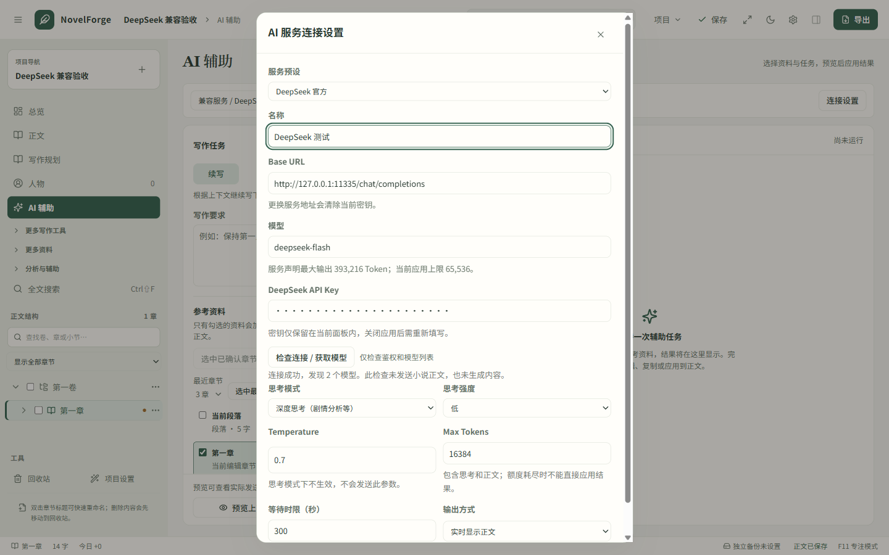
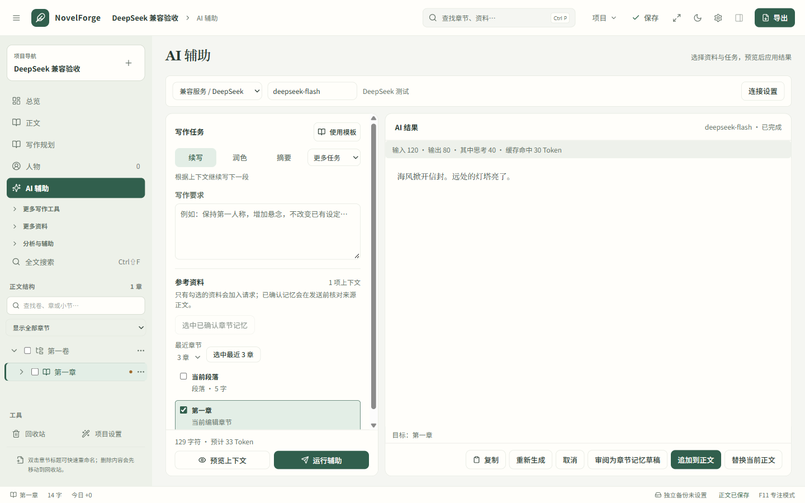

# DeepSeek 兼容支持

本功能自 NovelForge Studio `1.2.0-rc.6` 起提供，支持 DeepSeek 与通用 Chat Completions 服务。

## 使用

1. 运行 Release 下载的 `novelforge-studio.exe`，打开小说后进入 **AI 辅助**。如使用源码目录，可将程序放到 `desktop/novelforge-studio.exe`，再运行根目录的 `Start-Studio.ps1`。
2. 点击 **连接 DeepSeek**；已经使用其他兼容服务时，打开 **连接设置 → 服务预设 → DeepSeek 官方**。
3. 填写自己的 DeepSeek API Key，点击 **检查连接 / 获取模型**。这一步只请求模型列表，不提交小说内容、不生成文本；成功代表鉴权与模型列表接口可用，不代表已经完成真实生成测试。
4. 选择模型和输出方式。预设模型为 `deepseek-flash`，也可选择 `deepseek-v4-pro` 或填写模型列表返回的名称。
5. 选择续写、润色、摘要等任务，检查上下文后运行。生成完成后再决定是否应用到正文。

模型和思考参数依据 [DeepSeek 接入文档](https://api-docs.deepseek.com/)、[模型列表接口](https://api-docs.deepseek.com/api/list-models/) 和 [思考模式说明](https://api-docs.deepseek.com/guides/thinking_mode/) 实现，核对日期为 2026-11-12。内置模型名只是初始选项，连接检查支持发现服务当前提供的模型。

## 行为

- **普通写作**默认关闭思考，输出额度为 8,192 Token，实时显示正文。
- **深度思考**可选低、高、最高强度。开启时将过小的输出额度提高到至少 16,384 Token；Temperature 会禁用且不再发送。思考内容不会被显示为小说正文。
- DeepSeek 的应用输出上限为 **65,536 Token**，额度包含思考与正文；通用兼容服务保持原来的 32,000 上限。项目现有的上下文选择限制继续生效。
- 等待时限默认 300 秒，可在 30–600 秒之间调整。普通兼容服务默认仍为 120 秒。
- **实时显示正文**支持流式输出，也可切换为生成完成后显示。生成中或被截断的文本仅供查看/复制，完整结束后才允许应用。
- 支持停止接收。切换项目、章节或正文发生冲突后，旧结果不会直接覆盖当前稿件。
- 完成后显示服务实际返回的输入、输出、思考及缓存命中 Token 数；服务未返回的数据不会估算为费用。
- 区分密钥失效、余额不足、权限不足、模型/地址错误、限流、服务故障和等待超时。失败后由作者选择是否重试。
- API Key 只保留在对应面板的内存中，关闭应用后需重新填写。更换预设或服务地址会清除当前密钥；偏好存储明确排除密钥字段。
- 名字生成器采用相同的连接设置组件和请求构造规则，初始读取 AI 辅助已保存的参数。命名面板内的临时调整只作用于该面板，API Key 单独填写；仍只提交明确选中的命名资料和条件。

## 实现位置

- `src/components/ProviderSettings.tsx`：共享服务配置、模型检查、思考参数与输出方式。
- `src/lib/ai-provider.ts`：DeepSeek 预设、输出限制、请求配置与用量展示。
- `src/lib/api/tools.ts`、`src/stores/ai-task.ts`：流式事件接收与现有任务状态保护。
- `src-tauri/src/commands/ai/provider.rs`：HTTP 请求、模型发现、参数适配、错误分类和用量解析。
- `src-tauri/src/commands/ai/stream.rs`：支持 UTF-8 分片、SSE 保活和完成标志的解析器。

原有 `ai_complete` 和取消接口保留；新增 `ai_complete_stream`、`ai_models`。JSON 响应和正文保持 2 MiB 上限；流式传输允许额外的事件封装开销，同时限制单个事件及最终正文为 2 MiB。没有增加依赖或改变小说存储格式。

## 验证

新增测试覆盖普通/思考参数、兼容服务回归、密钥不落盘、过期模型列表响应、流式分片与完成状态、思考隔离、用量展示及命名入口。

最终结果：93 个前端测试文件、528 项测试通过；Rust 183 项通过，7 项沿用原有忽略状态；类型检查、配置检查、ESLint、Clippy 与 Windows 生产构建通过。72 组原生布局和原有抽屉/草稿交互检查通过。

DeepSeek 原生专项使用本地模拟服务完成 1 次模型列表请求和 5 次生成请求，验证流式/非流式、思考参数、Token 用量、取消、截断、余额不足错误、密钥不落盘，以及明确应用后的正文保存。发布资产附带 `SHA256SUMS.txt`，可用于核对下载的程序和安装包。

原生验收脚本：`node scripts/deepseek-ui-cdp.mjs`。它启动本地模拟服务和独立合成小说，检查真实桌面界面的连接设置、模型发现、正文流式显示、截断保护、取消连接、余额不足提示、非流式回退及作者确认后的保存。

本次不使用真实 DeepSeek API Key、不调用收费模型。协议与界面通过本地模拟服务验证；实际账户的模型权限、余额、网络连通性及生成质量需使用时确认。

## 验收截图（本地模拟服务）

