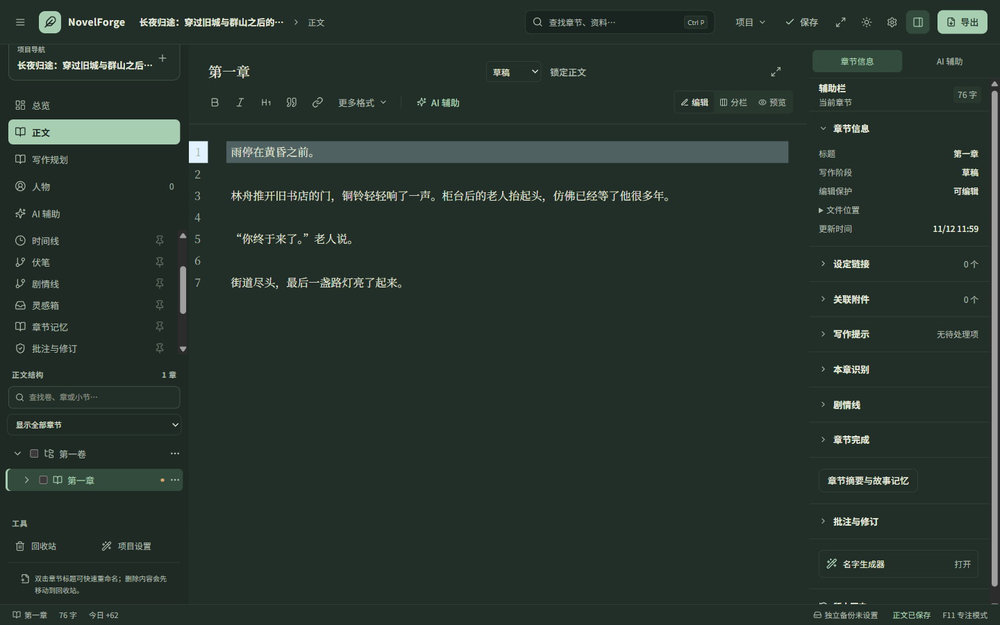

> 发布更新：本次重构和 DeepSeek 支持现已整理为 [1.2.0-rc.6](release-1.2.0-rc.6.md)。下文保留最初本地重构阶段的路径、基础版本与验收记录；当前下载和运行方式以 [README](../README.md) 为准。

# NovelForge Studio 重构说明

本目录是基于上游 `eb1e28effa5d19ad9e9a85bd01ebb00e270d8a90`（`1.2.0-rc.5`）创建的独立重构副本。原始下载目录为 `D:\NovelForge\source`，本副本位于 `D:\NovelForge\refactored`，工作分支为 `refactor/workspace-redesign`。

后续已加入 DeepSeek 支持，使用方法和新增验收结果见 [DeepSeek 说明](deepseek-support.md)。下方保留初次重构的交付记录。

## 本次调整

### 界面与交互

- 重新设计欢迎页：分栏展示创作入口和最近作品；支持按名称或路径搜索最近作品。
- 统一浅色与深色主题，使用青绿色、纸张色、清晰的表单层级与键盘焦点样式。
- 重做顶部工具栏：项目与当前功能位置、快速打开、保存、专注模式、主题、辅助栏和导出。
- 调整项目总览，突出继续写作、写作进度与最近修改；资料入口提供用途说明。
- 章节目录新增名称搜索，自动展示命中条目的所属卷和章节。匹配卷或章时保留下级内容，可与现有章节状态筛选一起使用，Escape 清除搜索。
- 保留可固定的功能入口、虚拟章节列表、快捷键、辅助栏抽屉和未保存草稿保护。
- 非正文页或未选择章节时进入专注模式，会显示明确的退出按钮。

### 模块职责

| 位置 | 职责 |
| --- | --- |
| `src/App.tsx` | 应用入口，转交给工作区容器 |
| `src/app/WorkspaceApp.tsx` | 工作区组合、项目弹窗与辅助栏布局 |
| `src/app/WorkspaceView.tsx` | 各功能页的视图分发 |
| `src/app/hooks/useWorkspaceLifecycle.ts` | 主题同步、自动保存、历史快照、统计刷新与会话清理 |
| `src/app/hooks/useWorkspaceContextMenus.ts` | 全局右键菜单与插件菜单适配 |
| `src/app/navigation.ts` | 导航元数据和工具栏当前位置名称 |
| `src/components/shell/` | 欢迎页、顶部栏、状态栏与拖动分栏组件 |
| `src/components/sidebar/` | 功能导航、章节行、索引和筛选算法 |
| `src/lib/api/` | 传输策略及项目、正文、修订、恢复、资料、工具六个接口模块 |
| `src/lib/api.ts` | 兼容现有调用与测试替身的统一接口 |
| `src/styles/tokens.css` | 字体、间距、颜色与浅深主题变量 |
| `src/styles/` | 基础、工作区、灵感、设置、AI、工作流及新版界面样式 |

接口拆分保留原有命令名称、参数、返回类型及桌面专用限制。正文保存、项目租约、外部冲突检测、备份恢复和数据库结构沿用原来的实现。章节列表改为先建立父子索引，再展开可见条目，减少长目录的重复扫描。

## 运行与继续开发

环境与上游一致：Node.js、pnpm 11.19.0；桌面构建需要 Rust、Windows C++ 编译工具和 WebView2。

```powershell
cd D:\NovelForge\refactored
pnpm install --frozen-lockfile
pnpm tauri:dev
```

`pnpm dev` 仅启动浏览器开发模式，其数据使用浏览器本地存储；实际小说文件的读写需使用桌面应用。

```powershell
pnpm typecheck
pnpm typecheck:config
pnpm lint
pnpm test
pnpm build
cargo test --manifest-path src-tauri/Cargo.toml --locked
pnpm tauri build --no-bundle
```

桌面构建输出为 `src-tauri/target/release/novelforge.exe`。交付时还会复制到 `desktop/NovelForge Studio.exe`，便于直接运行。应用显示名与标识已改为 `NovelForge Studio` / `com.novelforge.studio`，上游安装版保持原样。

## 验收记录

日志和截图位于被 Git 忽略的 `tmp/` 中；原生验收的合成项目及隔离配置位于操作系统临时目录。

- 重构前：91 个前端测试文件、519 项测试通过。
- 重构后：92 个前端测试文件、523 项测试全部通过；类型检查、配置类型检查、ESLint 和前端生产构建通过。最终测试命令为 `pnpm test --maxWorkers=2`。
- 新增覆盖：章节筛选的祖先与下级关系、折叠卷中的章节定位、最近项目搜索与打开、顶部快速打开与专注入口。
- 原生后端：174 项测试通过，7 项沿用上游忽略状态。
- 浏览器：1024、1440、1920 三种宽度，浅色与深色主题，共 72 组功能页布局检查通过；辅助栏草稿保留、菜单键盘操作、字数与固定导航复测通过。
- 最终 Windows 程序：同样的 72 组布局检查通过，章节搜索与清空、从总览退出专注模式、最近项目搜索与重新打开均通过；无未捕获的运行时异常。
- 真实桌面接口：项目租约、Unicode 正文、保存后重开、外部修改冲突保护、恢复副本、备份与恢复、导出正文、强制结束进程并重启后的独立草稿保留均通过。
- 最终可执行文件已复制到 `desktop/NovelForge Studio.exe`，与已验收构建的 SHA-256 一致；产品名、基础提交和校验值见 `desktop/BUILD-INFO.json`。
- 浏览器和桌面界面验收使用独立配置与合成稿件，不使用真实小说，也不调用收费 AI 服务。

## 界面预览




本次没有升级依赖、迁移小说格式或重新设计 Rust 存储层。保留上游版本号用于识别基础版本；本地重构不代表上游正式发布。README 下方的 GitHub 下载链接指向上游原版。

构建保留了 Vite 的大于 500 kB 分包提示，以及 Windows 链接器的库文件创建信息提示；二者均未阻止构建。这次没有引入懒加载边界，以保留原有编辑器、辅助栏与草稿的挂载生命周期。
